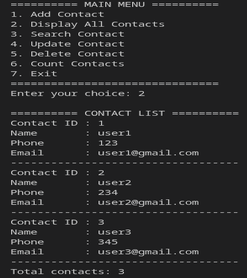

# Contact Management System Using Singly Linked List

A menu-driven **Contact Management System** developed in Java that demonstrates the practical implementation of a **Singly Linked List** for dynamic contact record management.

This project is developed as a Data Structures microproject to demonstrate how fundamental linked list operations can be applied to a real-world record management problem.

---

## Project Overview

Managing contact information manually can become inconvenient when records need to be frequently added, searched, updated, or deleted. Traditional methods such as maintaining physical registers or unorganized lists make record management less efficient.

The Contact Management System provides a simple digital solution that allows users to manage contact records through a menu-driven console interface.

The application uses a self-implemented singly linked list instead of Java's built-in `LinkedList` class. Each contact is stored inside a node, and nodes are connected through references to the next node.

## Objectives

- Implement a Singly Linked List from scratch using Java.
- Understand dynamic memory allocation and node-based data storage.
- Perform insertion, traversal, searching, updating, and deletion operations.
- Apply data structure concepts to a practical application.
- Analyze the time and space complexity of different operations.

## Features

- **Add Contact:** Add a new contact with an automatically generated unique ID.
- **Display Contacts:** View all stored contacts in insertion order.
- **Search Contact:** Search for a contact using its unique ID.
- **Update Contact:** Modify the name, phone number, and email address of an existing contact.
- **Delete Contact:** Remove a contact using its unique ID.
- **Count Contacts:** Display the total number of contacts currently stored.
- **Input Validation:** Handle invalid menu choices, non-numeric IDs, and empty required fields.

## Technology Stack

| Component | Technology |
|---|---|
| Programming Language | Java |
| Data Structure | Singly Linked List |
| Interface | Command-Line Interface (CLI) |
| Input Handling | Java Scanner |
| Development Environment | Any Java-compatible IDE or terminal |

## Data Structure Used

The project uses a **Singly Linked List** in which every node stores contact information and a reference to the next node.

### Node Representation

Each node consists of:

- **Data:** Stores a `Contact` object.
- **Next:** Stores the reference to the next node in the list.

### Linked List Structure

```text
HEAD
  |
  v
+----------------------+      +----------------------+      +----------------------+
| Contact 1            |      | Contact 2            |      | Contact 3            |
| ID: 1                |      | ID: 2                |      | ID: 3                |
| Name: Rahul          | ---> | Name: Priya           | ---> | Name: Aman            |
| Next ----------------|      | Next ----------------|      | Next: NULL            |
+----------------------+      +----------------------+      +----------------------+
                                                                  ^
                                                                  |
                                                                 TAIL
```

The implementation maintains three important variables:

- `head`: Reference to the first node.
- `tail`: Reference to the last node.
- `size`: Number of contacts currently stored.

Maintaining a tail reference allows insertion at the end of the list in constant time, O(1).

## Project Structure

```text
ContactManagementSystem/
│
├── Contact.java
│
├── ContactNode.java
│
├── ContactLinkedList.java
│
├── ContactManagerApp.java
│
└── README.md
```

### Class Responsibilities

| Class | Responsibility |
|---|---|
| `Contact.java` | Represents a contact with ID, name, phone number, and email. |
| `ContactNode.java` | Represents a linked list node containing a Contact object and next reference. |
| `ContactLinkedList.java` | Implements linked list operations such as insertion, searching, updating, deletion, and traversal. |
| `ContactManagerApp.java` | Contains the main method, menu-driven interface, and user input handling. |

## Operations and Time Complexity

Let `n` represent the total number of contacts stored in the linked list.

| Operation | Description | Time Complexity |
|---|---|---|
| Add Contact | Inserts a new node at the end using the tail reference. | O(1) |
| Display Contacts | Traverses the complete linked list. | O(n) |
| Search Contact | Searches sequentially using the contact ID. | O(n) |
| Update Contact | Searches for a contact and modifies its details. | O(n) |
| Delete Contact | Searches for the node and adjusts references. | O(n) |
| Count Contacts | Returns the maintained size variable. | O(1) |

**Space Complexity:** O(n), where `n` is the number of contacts stored.

## Getting Started

Follow the instructions below to download, compile, and run the application.

## Sample Outputs 



### Prerequisites

- Java Development Kit (JDK) installed.
- A terminal or command prompt.
- Basic familiarity with Java execution.

Verify your Java installation:

```bash
java -version
javac -version
```

### Installation

**1. Clone the repository**

```bash
git clone https://github.com/sohamrane0710-cpu/DS_MicroProject
```

**2. Navigate to the project directory**

```bash
cd ContactManagementSystem
```

If your repository uses a different folder name, navigate to that directory instead.

### Compilation

Compile all Java source files using:

```bash
javac Contact.java ContactNode.java ContactLinkedList.java ContactManagerApp.java
```

### Execution

Run the application using:

```bash
java ContactManagerApp
```

## Application Menu

When the application starts, the following menu is displayed:

```text
========== CONTACT MANAGEMENT SYSTEM ==========

1. Add Contact
2. Display Contacts
3. Search Contact
4. Update Contact
5. Delete Contact
6. Count Contacts
7. Exit

Enter your choice:
```

Select an option by entering its corresponding number.

### Example Workflow

A typical execution involves the following operations:

1. Add a contact named Rahul.
2. Add another contact named Priya.
3. Display all stored contacts.
4. Search for a contact using its ID.
5. Update the contact information.
6. Delete a selected contact.
7. Check the total number of remaining contacts.

The application automatically assigns IDs to newly created contacts during the current execution.

## Testing

The application can be tested using the following scenarios:

| Test Scenario | Expected Result |
|---|---|
| Add a new contact | Contact is successfully inserted. |
| Display all contacts | All existing contacts are displayed. |
| Search for an existing ID | Matching contact details are displayed. |
| Search for an invalid ID | Appropriate not-found message is displayed. |
| Update an existing contact | Contact information is modified. |
| Delete an existing contact | Selected contact is removed. |
| Display an empty list | Appropriate empty-list message is displayed. |
| Delete the only contact | Both head and tail references become null. |
| Enter invalid menu input | Invalid input is handled without terminating the application. |

## Limitations

- Contact information is stored only during the current program execution.
- All records are lost when the application terminates.
- The application uses a console-based interface.
- Searching requires sequential traversal of the linked list.
- Phone number and email format validation are not implemented.
- Authentication and access control are not currently available.

## Future Enhancements

The project can be extended with the following features:

- Database integration for permanent contact storage.
- File handling for saving and retrieving contact records.
- Graphical User Interface (GUI).
- Contact sorting and filtering.
- Import and export functionality.
- Phone number and email validation.
- Authentication and secure access control.
- Backup and recovery functionality.

## Learning Outcomes

Through this project, we gained practical experience in:

- Understanding and implementing singly linked lists.
- Creating nodes and managing references.
- Performing insertion, traversal, searching, updating, and deletion.
- Maintaining head, tail, and size variables.
- Handling edge cases such as empty lists and deletion of the last node.
- Applying time and space complexity analysis.
- Developing and testing a menu-driven Java application.

## Sustainability and SDG Alignment

The project demonstrates how digital record management can support sustainable practices.

- **SDG 9 – Industry, Innovation and Infrastructure:** Demonstrates the application of programming and data structures to develop a digital information management solution.
- **SDG 12 – Responsible Consumption and Production:** Provides a digital alternative to physical contact registers, potentially reducing paper usage.
- **SDG 4 – Quality Education:** Promotes practical learning of data structures, algorithms, and software development concepts.

These contributions are educational and project-level in scope.


## References

- [Oracle Java Documentation](https://docs.oracle.com/en/java/)
- [Java Platform Documentation](https://docs.oracle.com/en/java/javase/)
- Data Structures and Algorithms – Course Reference Material.
- Project implementation and testing.

---

**Developed as a Data Structures Microproject**

*Contact Management System Using Singly Linked List | Java*